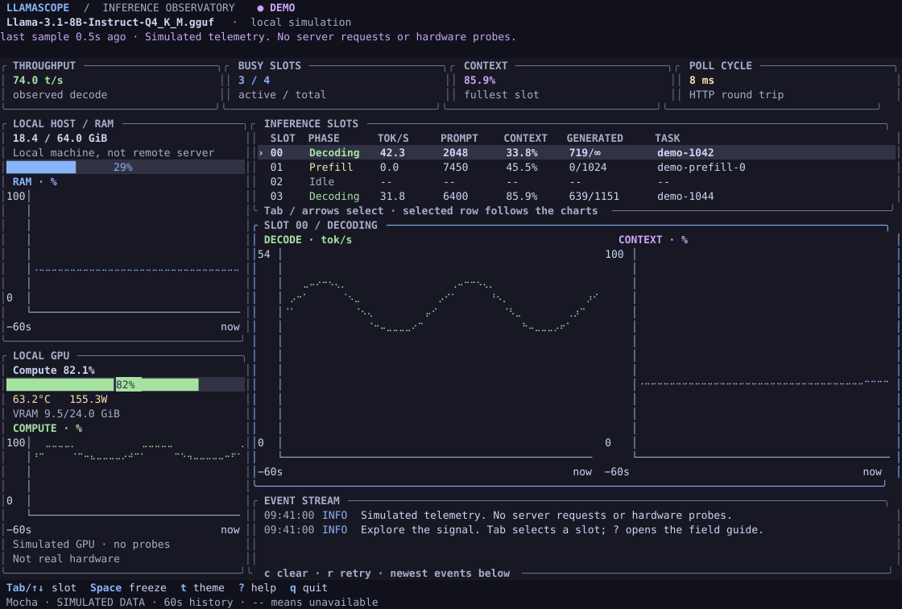

<div align="center">

# LlamaScope

### A clearer signal. A calmer terminal.

**A read-only observatory for `llama-server` inference.**<br>
Watch requests find their rhythm—from prompt ingestion to the last token—without leaving your terminal.

[](https://github.com/agustinsacco/llamascope/actions/workflows/ci.yml)
[](https://www.rust-lang.org/)
[](LICENSE)

[Quick start](#your-first-minute) · [Operator’s field guide](docs/guide.md) · [Architecture](docs/architecture.md) · [Contributing](docs/contributing.md)

</div>

<picture>
  <source media="(prefers-color-scheme: light)" srcset="docs/assets/dashboard-latte.svg">
  
</picture>

*Real terminal rendering, simulated workload. Reproduce it with the [snapshot example](docs/contributing.md#reproducible-screenshots)—not a hand-drawn product mockup.*

## Your first minute

**Just looking? No model, GPU, or server needed.** Install a current stable [Rust toolchain](https://rustup.rs), then:

```bash
git clone https://github.com/agustinsacco/llamascope.git
cd llamascope
cargo run --locked --release -- --demo
```

Press **Tab** to follow another slot, **t** to try the light theme, **Space** to freeze the view, and **?** for the built-in field guide. **q** or **Ctrl-C** restores your terminal and exits.

**Ready for live inference?** Run `llama-server` in another terminal:

```bash
llama-server -m /path/to/model.gguf --port 8086 --parallel 4
```

Then connect:

```bash
cargo run --locked --release -- --url http://127.0.0.1:8086
```

Current llama.cpp builds expose `/slots` by default. Do not start the server with `--no-slots`; older builds may require `--slots`. LlamaScope uses `/health`, `/slots`, and `/props`. It does **not** require `--metrics` or send completion requests.

> **Already using another port?** `8086` is LlamaScope’s default, not a claim about llama-server’s default. Pass your actual URL; do not append `/v1` to a normal server URL.

## Designed around four questions

| What you want to know | Where to look |
| :--- | :--- |
| **Is the server ready?** | Connecting, model-loading, live, degraded, offline, and stale states—with recovery guidance and sample age. |
| **Where is the work?** | Stable, keyboard-selectable slots with phase, throughput, prompt tokens ingested, context use, and—when there is room—generated tokens and task identity. |
| **What changed?** | Independent throughput/context chart scales, a 60-second window, and a bounded event stream that shows the newest events. |
| **Is this machine under pressure?** | Local RAM history; optional AMD or NVIDIA compute, VRAM (and AMD GTT), temperature, and power readings. Local sensors are explicitly **not** remote-server metrics. |

### Quiet by design, honest by default

- **Mocha after dark. Latte in daylight.** One semantic palette per theme, visible selected rows, and text labels that never depend on color alone.
- **A useful first frame.** Connection guidance and sensor discovery replace blank panels. Empty, unavailable, and disconnected are different states.
- **Failure is information.** HTTP errors and invalid JSON are explained—not silently converted into healthy empty responses. Last-known slot readings remain labeled during interruptions.
- **Unknown means `--`, not zero.** Missing prompt counters, temperatures, and first-sample rates stay visibly unavailable.
- **A terminal, not a trap.** Fallible setup, a cleanup guard, a panic-restoration hook, and explicit Ctrl-C handling protect normal use. `SIGTERM` and `SIGHUP` also restore the terminal. No software can restore it after `SIGKILL` or a terminal emulator crash.
- **No runtime service to operate.** A Rust binary built on [Ratatui](https://ratatui.rs/) and [Crossterm](https://github.com/crossterm-rs/crossterm). No browser frontend, database, or JavaScript runtime.

## Install once, observe often

```bash
curl -fsSL https://raw.githubusercontent.com/agustinsacco/llamascope/main/install.sh | sh
~/.local/bin/llamascope --demo

# Later: replace the binary with the newest release.
llamascope update            # or: llamascope update --check / --version 1.1.0
```

The installer downloads the release build for Linux (static, x86_64 or arm64) or macOS (Intel or Apple silicon), verifies it against the release `SHA256SUMS`, checks that it runs, and moves it into `~/.local/bin`. `llamascope update` does the same in place. Neither edits shell configuration; add `~/.local/bin` to your `PATH` yourself if necessary. While the repository is private, export `GH_TOKEN` or sign in with `gh` first, and fetch the script with `gh api -H "Accept: application/vnd.github.raw" repos/agustinsacco/llamascope/contents/install.sh | sh`.

```bash
# Choose another installation root, or pin a version.
curl -fsSL .../install.sh | PREFIX="$HOME/tools" sh -s -- --version 1.1.0

# Build this checkout with Cargo instead of downloading.
./install.sh --source

# Or stay inside the checkout; Cargo rebuilds only when necessary.
./start.sh --demo --theme latte

# Standard manual build.
cargo build --locked --release
./target/release/llamascope --help
```

Rust/Cargo is required to build, but not to run the resulting binary. Launchers forward arguments and propagate build failures. `CARGO_TARGET_DIR` works through Cargo; if you set it, the manual binary path changes accordingly.

## Make it yours

```bash
# Remote server: hardware panels still describe this local machine.
llamascope --url https://inference.example.com --theme latte --no-gpu

# A less frequent poll for a remote connection.
llamascope --interval 1000

# Environment configuration; CLI options take precedence.
export LLAMA_API_URL="http://127.0.0.1:8086"
export LLAMASCOPE_THEME="mocha"
llamascope
```

For authenticated servers, set **`LLAMA_API_KEY`** through your shell or secret manager. It is sent as a bearer token and is not printed in diagnostics. Prefer HTTPS for remote authentication. Credentials in URLs, query strings, and fragments are rejected; redirects are not followed.

| Option | Default | Meaning |
| --- | --- | --- |
| `--url URL` | `http://127.0.0.1:8086` | HTTP(S) server base URL, including an optional reverse-proxy path. |
| `--interval MS` | `500` | Poll cadence; accepted range `250–10000` ms. Slow requests cannot overlap. |
| `--theme mocha\|latte` | `mocha` | Initial palette. `t` toggles it for this session. |
| `--demo` | Off | Deterministic simulation; **no network requests or hardware probes**. |
| `--no-gpu` | Off | Disable GPU probes, retaining local RAM sampling. |
| `--help`, `--version` | — | Work without an interactive terminal. |

## The keyboard is the interface

| Key | Action |
| --- | --- |
| `Tab`, `↓`, `→`, `j` | Select the next slot; scroll the table as needed. |
| `Shift-Tab`, `↑`, `←`, `k` | Select the previous slot. |
| `Space` | Freeze/resume the displayed readings; collection continues. |
| `t` | Toggle Mocha / Latte. |
| `?`, `Esc` | Open/toggle help; close help. |
| `r` | Wake the next server poll; an in-flight request finishes first. |
| `c` | Clear the event stream. |
| `q`, `Ctrl-C` | Quit and restore the terminal. |

A **140 × 42** terminal is comfortable. At **80 × 24**, the inference view takes priority. Below **60 × 18**, a resize guide replaces a crushed dashboard. See the [layout contract](docs/design.md#layout-contract).

## Read the numbers responsibly

**This is an instrument panel, not a benchmark.** Token rates are sampled deltas for the same task, not end-to-end request throughput. Context is a token-count estimate, not physical KV-memory allocation. A fast request can finish between polls. Different llama.cpp versions expose different counters, and `/slots` does not report total prompt length, so there is no prefill percentage.

Hardware support is intentionally explicit:

| Capability | Linux | macOS | Other platforms |
| --- | --- | --- | --- |
| Server telemetry and demo | Yes | Yes | Not validated in CI |
| Local RAM | `/proc/meminfo` | `sysctl` + `vm_stat` estimate | Unavailable |
| Local AMD GPU | Optional `rocm-smi`, `card0`, VRAM + GTT | Normally unavailable | Not validated |
| Local NVIDIA GPU | Optional `nvidia-smi`, GPU 0 | Not applicable | Not validated |
| Apple GPU / remote GPU sensors | Not implemented | Not implemented | Not implemented |

Missing sensors never prevent inference monitoring. [Metric definitions and caveats →](docs/guide.md#the-metric-dictionary)

## Go deeper

- **[Operator’s field guide](docs/guide.md)** — connection states, reading the charts, bottleneck investigations, authentication, and troubleshooting.
- **[Architecture & protocol](docs/architecture.md)** — worker boundaries, request lifecycle, rate correctness, resource limits, and privacy.
- **[Design system](docs/design.md)** — themes, information hierarchy, compact layouts, and accessible terminal conventions.
- **[Contributor workshop](docs/contributing.md)** — local quality gates, protocol fixtures, real-input terminal tests, and reproducible screenshots.

### Quality gates

```bash
cargo fmt --all -- --check
cargo clippy --locked --all-targets -- -D warnings
cargo test --locked --all-targets
cargo build --locked
python3 tests/terminal_smoke.py
python3 tests/scripts_smoke.py
```

CI runs on Linux and macOS. Protocol tests use loopback fixtures; terminal tests send real keystrokes through a pseudo-terminal and check restoration of raw mode, cursor visibility, and the alternate screen. They do not require a model or GPU. Real hardware and llama.cpp releases still need integration validation; passing fixtures is not a promise of compatibility with every server build.

---

<div align="center">

**Keep the terminal. Lose the guesswork.**<br>
Created by [Agustin Sacco](https://github.com/agustinsacco) · [MIT licensed](LICENSE)

</div>
