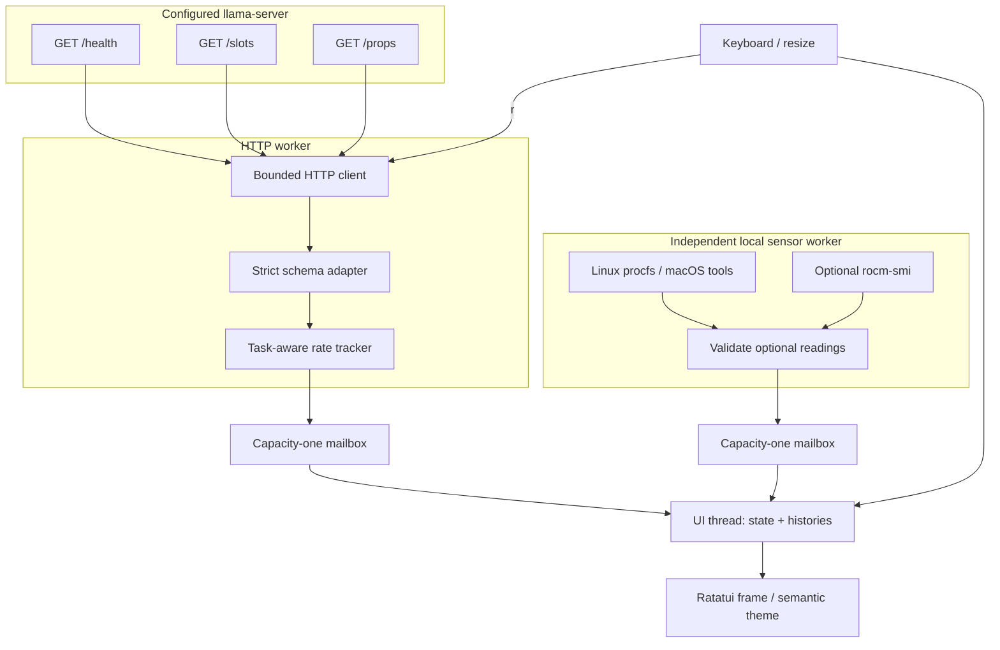

# Inside the observatory

[← Home](../README.md) · [Field guide](guide.md) · [Contributor workshop](contributing.md)

LlamaScope has one job: turn a read-only stream of incomplete, occasionally unreliable measurements into an understandable terminal view. The architecture keeps the renderer away from network and process I/O.

## The three lanes



### UI lane

`src/main.rs` drives an approximately 100 ms input/redraw loop. It takes available snapshots without blocking, processes key events, and draws from `AppState`. The only synchronous I/O on this path is terminal I/O.

A frozen view continues draining mailboxes into one pending server snapshot and one pending hardware snapshot. Resuming applies those latest snapshots. It does not backfill the frozen period or replay every intermediate connection event.

### HTTP lane

`Poller` uses a blocking Reqwest client on its own thread. A normal cycle requests health, then slots; props is added when metadata is missing or its 30-second cache expires. A failed earlier endpoint ends that cycle. Props failure leaves fresh slots available in a degraded snapshot.

```mermaid
sequenceDiagram
    participant UI as UI thread
    participant W as HTTP worker
    participant S as llama-server
    W->>S: GET /health
    S-->>W: ready / loading / error
    alt ready
        W->>S: GET /slots
        S-->>W: slot array
        W->>W: Validate + compute same-task deltas
        opt metadata missing or at least 30s old
            W->>S: GET /props
            S-->>W: metadata / error
        end
    end
    W-->>UI: Snapshot through bounded mailbox
    UI->>UI: Merge fresh data; label retained readings
    UI->>W: r: wake next poll
```

HTTP redirects are refused and TLS validation stays enabled. The bearer header is marked sensitive. Diagnostics use controlled error messages, not raw response bodies, credentials, or Reqwest errors that may contain a URL.

### Sensor lane

`hardware::sample` reads Linux memory without a subprocess, or uses macOS `sysctl` / `vm_stat`. Optional AMD sampling executes `rocm-smi -a --json` directly—not through a shell. GPU failure cannot block the network worker or remove valid host RAM.

Subprocess stdout is drained concurrently to avoid a full-pipe deadlock. Runtime and output are bounded. Timeout/error paths kill and reap the direct child. Tools that spawn descendants retaining stdout are outside the supported sensor contract; a timed-out stdout reader can outlive that individual sample until its pipe closes. Only trusted, locally installed sensor tools should be placed on `PATH`.

## State is a measurement, not a guess

`TelemetryData` carries connection classification, a safe diagnostic, optional slots, optional props, sample time, and HTTP-cycle duration. `AppState` merges successful fields rather than overwriting the whole screen with absent data.

| Input | State effect |
| --- | --- |
| Valid nonempty slot list | Replace rows, preserve selection by slot ID, append valid measurements. |
| Valid empty slot list | Clear rows, selection, and obsolete histories. |
| Missing/failed slot result | Retain last-known rows/history, mark them stale; do not append invented zeroes. |
| Props failure after valid slots | Degraded status, fresh rows/rates retained. |
| Recovered slots after failure | New rate baseline, not an average across the outage. |
| Different task in the same slot | Reset that slot’s rate/context history. |
| Identical connection failure | Do not duplicate the event on every poll. |

Selection follows **slot identity**, not response position. Rows are sorted by ID. Histories are retained using an ID set rather than a quadratic search through all slots.

### Rate correctness

A slot baseline stores `(task identity, decoded count, monotonic time)`. A rate is computed only when a busy slot has a known matching task, a nondecreasing count, and positive elapsed time. Otherwise it is unavailable. An unchanged count is a valid zero; a missing count is not.

Prompt/context metrics are optional because upstream payloads vary. `next_token` accepts the documented object and the legacy array shape the original LlamaScope adapter expected. Signed remaining counts allow unlimited generation. Malformed required fields, duplicate IDs, and incompatible envelopes are errors.

See the upstream [server endpoint reference](https://github.com/ggml-org/llama.cpp/blob/master/tools/server/README.md#api-endpoints) and the checked-in [fixture notes](../tests/fixtures/README.md). These are compatibility examples, not a guarantee that every future llama.cpp schema is supported.

## Resource and freshness budget

| Boundary | Limit / behavior |
| --- | --- |
| UI input wait | 100 ms per iteration, plus rendering/terminal I/O. |
| Poll interval | 250–10000 ms; default 500 ms. Requests never overlap within a worker. |
| HTTP connection / total request | 1 second / 2 seconds. |
| HTTP body | 2 MiB per endpoint; larger or incomplete bodies are rejected. |
| Slot list | At most 1024 slots per snapshot. |
| Metadata | Refresh after 30 seconds; retry after failure. |
| Local sensor interval | 2 seconds, independent of HTTP. |
| macOS subprocess | 500 ms per command. |
| AMD subprocess | 800 ms. |
| Subprocess output | 64 KiB; malformed/oversized output is unavailable. |
| Worker mailboxes | One item each; if full, a new sample is dropped rather than queued unboundedly. |
| Frozen pending data | One latest drained snapshot per source. |
| History | 60 seconds and at most 241 samples per series. |
| Events | Last 100 entries; display the newest entries that fit. |
| Display text | Control/bidirectional formatting characters removed; labels bounded to 160 characters. |
| Staleness | Three poll intervals, minimum 3 seconds; failed slot attempts mark retained rows immediately. |

History x-values are monotonic elapsed seconds, not sample indices. Chart windows are anchored to the last recorded sample, with a `−60s → now` axis; “now” means that series’ last recorded time. The header’s sample age and last-known/frozen labels qualify retained data. Charts connect observed points and do not imply measurements between them.

## Terminal lifecycle

1. Parse options and validate URL, interval, theme, and bearer-header syntax **before** changing the terminal.
2. `--help` and `--version` return without requiring a TTY. Interactive mode checks stdin/stdout first.
3. Create a restoration guard before fallible Ratatui initialization.
4. Ratatui installs its panic-restoration hook; the guard handles ordinary error returns and normal quit.
5. Restore the screen before stopping/joining collectors. Both workers receive a stop request before either is joined, preventing a queued retry from starting another cycle on shutdown.
6. An already running HTTP cycle can finish within its request deadlines (up to roughly six seconds for three requests). The terminal has already been restored while this shutdown completes.

Normal `q` and Ctrl-C exits are exercised in a real pseudo-terminal. Panic restoration relies on Ratatui’s installed hook; `SIGKILL`, emulator crashes, and externally imposed process termination cannot be made cleanup-safe.

## Code map

| File | Responsibility |
| --- | --- |
| `src/config.rs` | Configuration precedence, validation, noninteractive help. |
| `src/telemetry.rs` | Endpoint handling, protocol decoding, rate tracking, worker lifecycle. |
| `src/hardware.rs` | Optional local sensor collection and numeric validation. |
| `src/app.rs` | View state, bounded history/events, key actions, responsive presentation. |
| `src/theme.rs` | Semantic Mocha and Latte palette tokens. |
| `src/demo.rs` | Deterministic simulation; no I/O. |
| `src/main.rs` | Terminal ownership, snapshot delivery, freeze/resume, event loop. |
| `examples/snapshot.rs` | Export the actual Ratatui test buffer to SVG. |
| `tests/` | Config, protocol, state, rendering, contrast, PTY, and script regression checks. |

## Privacy and trust boundaries

LlamaScope performs only GET requests to the configured server and local sensor reads. It does not implement analytics, persistent history, inference submission, or server mutations. Network requests may follow the system’s proxy configuration; use trusted proxy settings and HTTPS where appropriate.

Server bodies may contain sensitive fields even when LlamaScope does not display them. Responses are transiently read to decode telemetry; unknown fields are ignored, and raw response bodies are not logged. Model basenames, task IDs, server addresses, and operational measurements may appear on screen. Treat screenshots as potentially sensitive.

The application’s request/probe-free demo guarantee does not include Cargo downloading dependencies while building the binary. Once built, `llamascope --demo` makes no application-level network requests or hardware probes.
