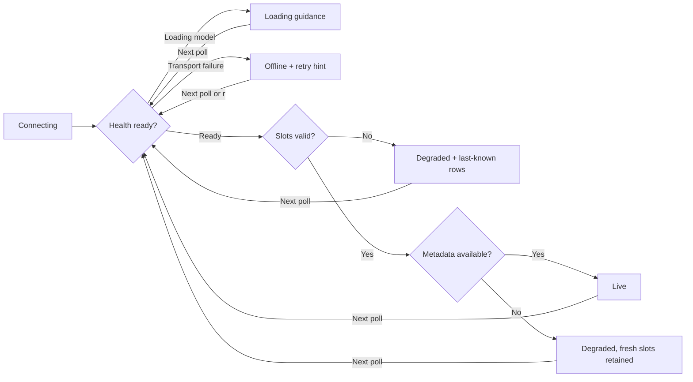

# The operator’s field guide

[← Home](../README.md) · [Architecture](architecture.md) · [Design](design.md)

> Start with a question, not a percentage: **am I waiting for the model, the prompt, a slot, or the next token?**

## A 90-second orientation

1. Run `llamascope --demo`. The **DEMO** badge stays visible; every reading is simulated.
2. Read the top cards: aggregate observed decode rate, occupied slots, highest known context estimate, and HTTP poll-cycle duration.
3. Press `Tab` until slot 1 is selected. Its prompt is still in prefill; generating no tokens is expected.
4. Select slot 3. Its context estimate is high. This is a reason to investigate context pressure, not proof of a memory leak.
5. Press `Space`. Values and their displayed age freeze; collectors keep running. Resume to jump to the latest collected snapshot.
6. Press `t` and `?`. The same instrument has a daylight palette and an onboard reference.
7. Quit with `q` or `Ctrl-C`, then connect to your own server with `--url`.

Demo waveforms illustrate the interface. They are not measured performance or a model recommendation.

## Connection states: tell waiting from failure

| State | What it actually means | What to do |
| --- | --- | --- |
| **CONNECTING** | No completed server poll yet. | Wait for the first bounded request cycle. |
| **MODEL LOADING** | `/health` returned HTTP 503 with `Loading model`. | Let llama-server finish loading weights. LlamaScope retries automatically. |
| **LIVE** | Health, slots, and required metadata refresh succeeded. | Inspect the workload. Idle slots are a healthy state. |
| **DEGRADED** | A reachable endpoint returned an HTTP/schema/body error. | Follow the displayed hint. `/props` failure does not discard valid slot readings. |
| **OFFLINE** | A request failed at the transport layer or timed out. | Check the URL, network, TLS, or server process. `r` schedules a retry. |
| **STALE** | A previously live slot snapshot is older than the freshness threshold. | Check whether a request is slow or collection has stalled. |
| **FROZEN** | You froze the view. This takes precedence over the connection badge. | Press `Space` to resume; it does not stop server requests or pause inference. |
| **DEMO** | Local simulation. This is not a live server connection. | Omit `--demo` to connect. |

The stale threshold is **three poll intervals, with a minimum of three seconds**. When a failed poll provides no slots, existing rows are immediately marked **LAST KNOWN**, even before the age threshold. Empty success (`[]`) is different: it clears old rows and explains that no slots were reported.

Repeated identical failures produce one event, not one warning per poll. Connection transitions and changed messages produce new events. Only the newest visible events are shown, with a 100-entry memory cap.

### Recovery is automatic



`r` does not cancel an in-flight HTTP request. It wakes the next poll; rapid retries are coalesced. Each request has a two-second total timeout and a one-second connection timeout. Normally a poll contains two requests; a metadata refresh adds a third.

## The metric dictionary

### Throughput / TOK/S

For a busy slot with a known, unchanged task identity:

```text
tokens per second = (current decoded count − previous decoded count)
                    / actual elapsed seconds between slot samples
```

- The first observation is `--`: one count does not establish a rate.
- A new task, a decreasing counter, idle transition, removed slot, or failed slot poll resets the baseline.
- An unchanged counter on the same task yields a genuine `0.0`.
- Missing task identity or decoded count yields `--`; continuity cannot be proven.
- Idle slots show `--` in the table; they contribute zero to the aggregate.
- If any busy slot lacks a valid rate, the aggregate is `--`, rather than an unexplained partial sum.
- A successful poll with zero busy slots has aggregate throughput `0.0`.

These are **observation-window rates**, not tokens divided by full request latency. Sampling can miss a short request entirely. Prefill can legitimately have a zero decode rate. Speculative decoding and llama.cpp counter semantics may affect interpretation.

### Phase

| Label | Rule |
| --- | --- |
| **Idle** | `is_processing` is false. |
| **Prefill** | Busy, with reported processed prompt tokens less than total prompt tokens. |
| **Decoding** | Busy, not known to be in prefill, with decoded tokens greater than zero. |
| **Working** | Busy, but the exposed counters do not establish a more specific phase. |

The word **Working** is deliberate: no guessing that an undocumented state means prefill.

### PREFILL

`100 × n_prompt_tokens_processed / n_prompt_tokens`, clamped to `0–100%`. Both fields and a positive total are required. Missing counters are common on stock `/slots` responses; `--` does not mean the prompt is stuck.

### CTX EST. / Context estimate

`100 × (processed prompt tokens + decoded tokens) / n_ctx`, using saturating integer addition and a clamped `0–100%` display.

This estimate requires all three counters and a positive context size. It is **not** physical KV allocation, a byte count, or an exact measurement after context shifting, cache reuse, or speculative decoding. The top card is the highest *known* value; an unknown slot is not interpreted as zero.

### Generated tokens

On wider layouts, the table shows `decoded / (decoded + remaining)`. Negative remaining counts, including llama.cpp’s `-1`, are shown as `decoded/∞`: there is no finite remaining-token target. If remaining is missing, only the decoded count is shown. This is not an ETA.

### Poll cycle

Wall-clock duration of the HTTP collection cycle, not model latency and not GPU probe time. The interval targets cycle start times; if a cycle is slower than the configured interval, the next cycle begins after the current one finishes. Polls never overlap.

### RAM, VRAM, compute, temperature, power

- **Units:** memory is GiB (`1024³` bytes), not decimal GB. Linux `/proc/meminfo` values are converted from KiB.
- **Linux RAM:** `MemTotal − MemAvailable`; this avoids treating all reclaimable page cache as unavailable.
- **macOS RAM:** total from `sysctl`; estimated used memory subtracts free, inactive, and speculative pages using `vm_stat`’s reported page size. It is not Activity Monitor’s “Memory Pressure” metric and will not necessarily match its accounting.
- **GPU:** optional `rocm-smi -a --json`, reading `card0`. Individual missing/non-numeric sensors remain unavailable. VRAM values are reported only when both used and total are valid.
- **Scope:** all hardware panels describe the machine **running LlamaScope**, even if `--url` points elsewhere. Monitor remotely over SSH if you want sensors from the inference host.
- **Cadence:** local hardware is sampled independently every two seconds. No GPU utility is required for RAM or inference telemetry.

There is no NVIDIA, Apple GPU, multi-GPU aggregation, remote sensor agent, or automatic thermal-throttling detection in this version.

### Queue and metadata

Model basename and build metadata come from `/props`, refreshed every 30 seconds during healthy polling. Failures trigger retries. Queue depth is shown only if `queue_size` is actually present; standard llama.cpp `/props` may omit it. LlamaScope does not synthesize a queue from busy slots and does not query Prometheus metrics.

## Three investigations worth trying

### “My first token takes forever.”

1. Is the server **MODEL LOADING**? That is model startup, not prompt processing.
2. Is the slot **Prefill**? Inspect prompt progress if your server exposes it.
3. Compare long and short prompts under the same model and batch configuration.
4. If prompt counters are absent, use server logs or request timing instrumentation. Do not infer prefill duration from a flat throughput chart alone.

### “Throughput falls as the conversation grows.”

1. Follow the **same slot and task**, not whichever slot happens to be first.
2. Compare its throughput chart with the independent context estimate chart.
3. Check whether another slot became active; concurrency changes per-request throughput.
4. On the actual inference host, inspect compute, memory, and temperature.
5. Change one setting at a time—context, parallelism, prompt length—and measure again. Correlation in the charts is a lead, not a diagnosis.

### “Requests are piling up.”

1. Are all slots busy over multiple samples?
2. Is queue depth actually reported? `--` does not mean no queued requests.
3. Inspect client-side request latency or enable external metrics to confirm queuing.
4. Consider additional slots only after checking available memory and aggregate throughput. More parallelism can reduce per-request speed.

## Troubleshooting without superstition

| Symptom | First check | Important distinction |
| --- | --- | --- |
| Connection refused | Is llama-server running at the exact `--url` host and port? | The default monitor port is `8086`; your server may use another. |
| HTTP 401 / 403 | Set `LLAMA_API_KEY`; inspect server/proxy permissions. | Health can be public while slots and props are protected. |
| `/slots` HTTP 404 / 501 | Remove `--no-slots`; check version-specific `--slots`. | A reachable server is not necessarily a monitor-enabled server. |
| Redirect refused | Use the final HTTP(S) URL directly. | Refusing redirects keeps authentication and endpoint routing explicit. |
| TLS failure | Check hostname and certificate trust. | There is deliberately no “disable certificate validation” flag. |
| Invalid JSON/schema | Check that the base URL targets llama-server, not an HTML proxy page or incompatible API. | LlamaScope will not turn a malformed payload into an empty healthy list. |
| All prompt/context cells are `--` | Inspect your server’s `/slots` fields. | Many builds omit those optional fields; decoding rate can still work. |
| GPU panel unavailable | Is a compatible `rocm-smi` installed, executable, and working for `card0`? | CPU-only and macOS inference monitoring still work. |
| Wrong machine’s RAM | Did you pass a remote URL? | Local sensors are local by design. |
| Charts stopped changing | Check **FROZEN**, sample age, and **LAST KNOWN**. | Freeze is a view control, not a paused inference request. |
| Cannot see local sensors or events | Enlarge the terminal to at least `110 × 33`. | Compact layouts prioritize slots and charts. |
| Shell looks odd after a forced kill | Run `reset` in the terminal. | Normal errors/quits are guarded; `SIGKILL` cannot run cleanup. |

For direct troubleshooting, `curl --fail-with-body http://127.0.0.1:8086/health` is a safe health check on an unprotected local server. Avoid sharing raw `/slots` or `/props` responses: depending on your server version they can include prompts, paths, and other private data.

## Operational boundaries

- A single direct llama-server base URL per process. Router-mode model query parameters are not supported.
- No inference submission, cancellation, slot restoration, model downloads, or server configuration changes.
- Histories and events are in-memory only. Closing the app discards them.
- No desktop notifications, analytics, external telemetry, or automatic update checks are implemented.
- Theme toggles and selection are session-local. Persist the initial theme using `LLAMASCOPE_THEME`.
- During freeze, only the most recent pending snapshot is kept; intermediate samples and transient events are not replayed on resume.

[Back to quick start →](../README.md#your-first-minute)
